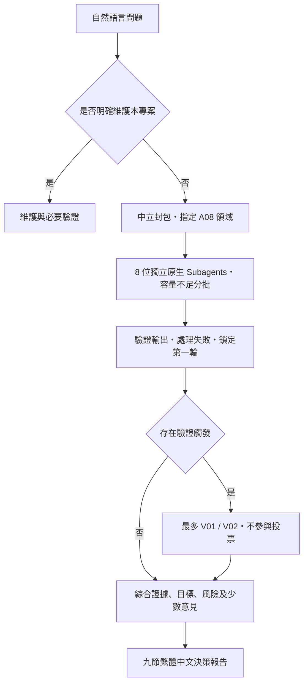

# Perspective Council V1.0

在 Codex 正常對話輸入框輸入一個想法或決策問題，Council Orchestrator 便會依
專案規範委派真正的 Subagents，收集獨立判斷、必要時追加驗證，再產生繁體中文報告。
沒有網頁、資料庫、外部 Agent Framework 或執行期 Python／Node Orchestrator。

## 開始使用

初始化完成後，在 **此 Repository 開啟新的 Codex 對話**，讓新設定與 AGENTS.md
在新會話載入。一般評估使用唯讀權限，直接輸入，例如：

> 我想在 Embedded Linux 專案採用 Rust 取代部分 C，值得嗎？

> 內部知識庫要選 GitHub Markdown、託管 Wiki，還是維持共用文件？

不需要 `/review`、選 Agent、執行 CLI 或手動推進下一步。資訊不完整時，系統先
明示合理假設並繼續；只有連評估對象都無法辨識才詢問必要資訊。
流程可能需要數分鐘，也會比單代理消耗更多使用額度；不額外要求 API Key 或付費 API。

若 Codex 顯示專案設定尚未受信任，需先依宿主介面完成一次性專案信任設定；
本專案不會修改全域信任、權限或登入狀態。上層管理政策與實際工具能力優先。
沒有真正 Subagent 工具時會明示 Council 未執行，不讓主代理假扮八位評審。

## 架構



Main Agent 不在盲審前透露偏好。每位評審收到相同中立封包、自己的角色及輸出
契約，使用全新 context。第一輪全部提交或耗盡恢復次數後，才能整合與啟動第二輪。

| ID | 原生角色名稱 | 分工 | 推理強度 |
| --- | --- | --- | --- |
| A01 | advocate | 有條件的最強支持理由 | medium |
| A02 | skeptic | 假設、反例及缺陷 | medium |
| A03 | risk_analyst | 失敗模式、後果、不可逆風險 | medium |
| A04 | feasibility | 技術、執行、資源與時程 | medium |
| A05 | economist | 成本、效益與機會成本；不適用為 N/A | medium |
| A06 | human_analyst | 體驗、行為、團隊與倫理 | medium |
| A07 | innovator | 替代、折衷與問題重述 | medium |
| A08 | domain_specialist | 派發前指定的動態專業 | high |
| V01 | fact_verifier | 具體事實與來源查核 | high |
| V02 | risk_auditor | 重大風險與緩解查核 | high |

支援想法、可行性、決策、多方案比較、技術架構、風險及開放式探索。
單方案使用四類票；多方案使用完整排名、並列、首選與不可比較缺口。
每個方案都有六維度 1–5 或 N/A 評分與理由。票數與信心不是成功機率，
最終判斷不能只按多數決；可信的單一重大反對意見也必須審查。

第二輪在重要事實矛盾、有根據重大風險、三位核心證據不足、高風險不可逆後果
或足以推翻建議的爭議時觸發；純價值分歧不啟動事實查驗。
沒有足夠資料時保留 UNRESOLVED，驗證代理不投票、不改動第一輪。

## 檔案清單

```text
perspective-council/
├── AGENTS.md                       # 模式路由與原生委派要求
├── README.md
├── .gitignore
├── requirements-dev.txt            # 僅維護測試使用
├── .codex/
│   ├── config.toml
│   └── agents/
│       ├── advocate.toml
│       ├── skeptic.toml
│       ├── risk_analyst.toml
│       ├── feasibility.toml
│       ├── economist.toml
│       ├── human_analyst.toml
│       ├── innovator.toml
│       ├── domain_specialist.toml
│       ├── fact_verifier.toml
│       └── risk_auditor.toml
├── protocols/
│   ├── review_workflow.md
│   ├── blind_review.md
│   ├── voting.md
│   ├── verification.md
│   └── final_report.md
├── schemas/
│   ├── review_packet.schema.json
│   ├── review_result.schema.json
│   └── verification_result.schema.json
└── evals/
    ├── test_cases.md
    ├── acceptance_criteria.md
    ├── council_checks.py            # 純驗證函式，沒有派發功能
    ├── validate.py
    ├── check_codex.py
    ├── check_smoke.py
    ├── test_council.py
    ├── fixtures/
    │   ├── embedded_linux.packet.json
    │   ├── product_idea.packet.json
    │   ├── option_comparison.packet.json
    │   └── critical_flaw.packet.json
    └── results/
        ├── validation.md
        └── smoke/
            ├── A01.json
            ├── A03.json
            ├── A08.json
            ├── V02.json
            ├── round_one.lock.json
            ├── audit.json
            └── report.md
```

## 設定與版本相容性

2026-11-04 初始化時本機為 `codex-cli 0.166.0-alpha.6`。
已核對官方文件，並以本機原生 strict parser 測試：

```toml
sandbox_mode = "read-only"
approval_policy = "on-request"

[agents]
enabled = true
max_concurrent_threads_per_session = 8
default_subagent_reasoning_effort = "medium"
```

`.codex/agents/*.toml` 使用目前的獨立檔格式：`name`、`description`、
`developer_instructions`、`model_reasoning_effort`，由專案目錄探索載入。
未硬編碼模型，繼承使用者有權使用的模型。未加入自行發明的設定鍵、舊式
feature flag、外部服務或不必要高權限。

原生 prompt-input 診斷已確認 AGENTS.md 進入模型輸入，且 spawn 工具描述包含
全部 10 個自訂角色與對應推理強度；此項證明探索載入，不等於實際選角派發。
此初始化對話只有通用 collaboration 工具，Smoke Test 因此採全新 context
讀取自己的角色指令與 Schema 的原生適配；沒有宣稱已透過自訂 agent_type 派發。
一般新會話若提供角色選擇器，就直接使用其支援的角色參數。

設定中的 8 是子代理並行上限，主代理不計入；實際宿主可限制更低。
本次對話只有 4 個活動槽位（含主代理），所以原生 Smoke Test 使用
3 位評審加鎖票後的 1 位驗證。一般評估仍以八位為目標、依容量分批。
設定檔不會熱更新目前對話已提供的工具或權限，因此首次使用請重新開啟對話。

官方依據：

- [Subagents](https://learn.chatgpt.com/docs/agent-configuration/subagents)
- [Configuration Reference](https://learn.chatgpt.com/docs/config-file/config-reference)
- [AGENTS.md 載入方式](https://learn.chatgpt.com/docs/agent-configuration/agents-md)

## 權限與兩種模式

**一般評估**：父會話以 read-only 為原則，封包及結果留在父代理記憶；不修改
Repository、不實施提案、不寄信、不購買。可使用宿主已允許的唯讀證據工具。
網路／資料不可取得時揭露限制，不能繞過核准或把未開啟來源標為已驗證。

**專案維護**：僅在明確要求建置、修改、測試或修復本 Council 時啟用。需要
Codex 介面授予 workspace-write 才能改檔；根設定保留 read-only 預設，不會
為了維護自動切成高權限。初始化測試證據可在此授權範圍存入 evals/results。
要恢復評估只需使用唯讀新會話並輸入決策問題，不需改設定。

## 盲審與原生能力限制

- **Context Isolation**：使用不同原生子代理及停用歷史繼承。可稽核派發參數，
  無法單靠本專案證明模型內部完全獨立；同模型仍可能有相關偏誤。
- **Workspace Isolation**：子代理可能共用 Repository，沒有各自 worktree／ACL。
  不落地第一輪回覆及禁止讀取 peers 是流程規範，不能當作強制檔案隔離。
- **Tool Permission Isolation**：子代理可能繼承父權限；角色檔指令不建立獨立
  sandbox。安全邊界由宿主提供，本專案不宣稱工具或權限已強制彼此隔離。
- `AGENTS.md` 是模型遵循的流程，不是背景常駐服務。宿主停用委派或強制繼承
  歷史時，不能保證完整流程／盲審，必須如實回報，不以模擬替代。
- JSON Schema 可驗證結構與部分條件，方案完整、排名及證據參照由語意檢查補足；
  引用真實性、重大性、推論合理性仍需主代理與驗證者判讀。一般評估中，若
  唯讀環境不能執行 Python 檢查，主代理按同一契約檢查並揭露未做機械式驗證。
- 首輪有效回覆不可改票。失敗可重試一次，之後按實際有效票及缺席角色報告；
  不能補造缺席意見。最多兩個驗證身份，每個同樣最多一次恢復重試。

## 維護測試

普通使用者不需要以下步驟。維護者使用 Python 3.9+；Python 3.11+ 有內建 TOML
解析器，舊版使用 tomli。依賴只供離線 Schema 與契約驗證，不呼叫模型或 API。

```sh
python3 -m venv /tmp/perspective-council-dev
/tmp/perspective-council-dev/bin/python -m pip install -r requirements-dev.txt
/tmp/perspective-council-dev/bin/python evals/validate.py
/tmp/perspective-council-dev/bin/python -m unittest discover -s evals -p 'test_*.py' -v
/tmp/perspective-council-dev/bin/python evals/check_codex.py
/tmp/perspective-council-dev/bin/python evals/check_smoke.py
```

若測試環境沒有網路，可用已安裝的相依套件；未取得依賴時不得宣稱 Schema 驗證通過。
`check_codex.py` 不執行模型，只跑版本、原生設定解析和 prompt-discovery 診斷；
宿主限制診斷所需的本機 runtime 存取時會標示 UNVERIFIED。
可以在授權環境保存 `codex debug prompt-input` 的 JSON 到暫存路徑，再以
`check_codex.py --prompt-input-json <暫存檔>` 檢查，勿將含使用者設定的完整 prompt 提交。

另可驗證個別回覆：

```sh
/tmp/perspective-council-dev/bin/python evals/validate.py \
  --packet evals/fixtures/critical_flaw.packet.json --review evals/results/smoke/A01.json
```

初始化的 39 項合成契約測試已通過，原生縮小 Smoke Test 的證據與九節報告另存
`evals/results/`。完整結果及尚未實測的部分見
[validation.md](evals/results/validation.md)；後者包括八人完整執行、新會話自然語言
觸發，以及所有原生故障／逾時／重試路徑。合成測試不冒充原生執行。
