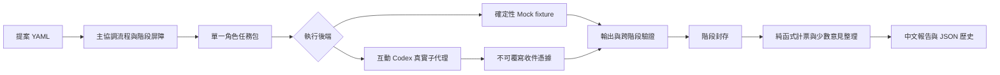

# 架構

## 執行邊界

主代理是 Python 工作流程加上原生互動模式中的 Codex 協調者。Python 不擁有聊天內子代理工具，Codex 不負責修改選票。任務包與原始回覆是兩者間的明確介面。



## 模組

| 模組 | 責任 |
|---|---|
| `domain.py` | Vote、Capabilities、Response、領域錯誤 |
| `config.py` | 安全 YAML、指定角色集合、封裝資源 |
| `validation.py` | JSON Schema、代理 ID、立場變化、一致性 |
| `backends.py` | Backend Protocol、MockBackend、NativeBackend、原生收件 |
| `workflow.py` | 唯一 ID、階段屏障、並行、重試、復原、收尾 |
| `aggregation.py` | 唯一陪審員檢查、有效票、多數、缺件、分歧與共同假設 |
| `reporting.py` | 十四節中文報告，不再呼叫 LLM 新增推論 |
| `storage.py` | UTF-8、原子狀態、不可覆寫封存、程序鎖 |
| `cli.py` | 檢視、驗證、示例、評估、歷史與原生協調命令 |

`Backend.execute(task, attempt, directory)` 回傳 `Response` 或拋出例外。`PendingTask` 代表尚待外部執行，不等於錯誤；一般執行或 schema 錯誤消耗重試預算。`Capabilities` 宣告模式、上下文／續接能力、模型與用量是否可取得。新後端可以直接接此協定；主流程只接受與封存設定相同的後端能力。

## 隔離與並行

初評任務僅含原提案、自己的角色與共同量表。開場看不到對方開場。反駁僅見兩份已封存開場。終評只見自己的初評及完全相同的四份辯論，不含其他陪審員投票。

`ThreadPoolExecutor` 限制 Python 後端同時執行數；原生子代理的實際並行另由 Codex 主代理遵守 `max_concurrency` 及客戶端空位。Python 發布十二份任務不代表同時或實際啟動十二個代理。

原生初次建立必須使用不繼承父對話的新上下文。若可以續接，提交相同 ID 與 `context_mode=resumed`；否則建立新上下文並填 `fresh`。同一 ID 不能跨角色，重試不能重用同階段上下文。這些檢查驗證操作者提供的識別資訊，不能認證工具確實執行過。

共享檔案系統不等於隔離沙箱。原生代理收到直接嵌入的任務 JSON，不取得檔案路徑，並被明確禁止工具與讀檔。本版沒有自動研究功能，因此回覆不得宣稱外部證據已被查證。

## 保存與復原

```text
results/<評估ID>/
  idea.json                 原提案
  snapshot.json             角色、設定、提示、schema、後端、fixture 快照
  state.json                唯一可變檢查點
  tasks/<階段>.<角色>.json   含 SHA-256 的隔離任務
  responses/...json         原生回覆與操作者聲明的執行識別
  attempts/...json          每次原始輸出或錯誤（含重試）
  phases/...json            完成或明確失敗後的階段封存
  aggregate.json            計票、缺件、少數與共同假設
  result.json               最終狀態與彙整
  report.md                 十四節中文報告
```

檔案先寫入同目錄暫存檔並 fsync，再用硬連結不可覆寫地建立封存；狀態用 `os.replace` 原子更新。程序鎖使用 POSIX `flock`，程序中斷時自動釋放。`.lock` inode 保留，避免刪除／重建造成競態。

已封存嘗試在復原時直接讀取，不再次執行模型。階段完成後才發布下一階段。收尾先寫 `finalizing`，若報告產生中斷，續跑補足缺少的最終檔案。已完成評估不重新生成報告。

保存的 SHA-256 用來辨識任務內容，不是防竄改簽章。保護歷史採不覆寫與檢查點策略；不宣稱能防止有寫入權限的操作者竄改檔案。模型版本、抽樣與服務端行為仍可能無法完全重現。
